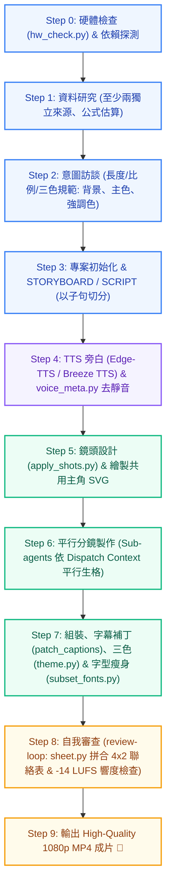

# 🎬 Motion Explainer — 從一句話到一支解說動畫 (HyperFrames AI Agent Skill Suite)

> 專為 **Google Antigravity**、**Claude Code**、**Cursor** 與 **Codex** 打造的原理解說動畫全流程 AI Agent 技能套件。  
> 透過 **HyperFrames**（HeyGen 開源，HTML + GSAP）結合中文旁白語音合成、智慧字幕對齊、三色主題自動化、中文字型極致瘦身（小 98%）與視覺自我審查循環（Contact Sheet Review Loop），將「自然語言需求」一鍵轉化為直接可上課投影或上傳 YouTube 的照片級/向量級 1080p 60fps MP4 動畫！

[](https://github.com/JeffreyHo0520/motion-explainer)
[](https://github.com/JeffreyHo0520/motion-explainer)
[](https://github.com/heygen-oss/hyperframes)
[](https://greensock.com/gsap/)
[](https://www.python.org/)
[](LICENSE)

---

## 📦 3-in-1 全套技能組合 (Included Skills Suite)

本儲存庫整合了打造高品質動態解說影片不可或缺的三大核心技能：

| 斜線指令 (Slash Command) | 技能名稱 | 職責與定位 |
| :--- | :--- | :--- |
| **`/motion-explainer`** | **Motion Explainer** | **端到端動畫製作總管**：負責資訊檢索、需求訪談、分鏡與腳本編排、TTS 中文旁白生成、時間軸切分、共用 SVG 主角設計、平行 Sub-agent 派工、畫面組裝、字幕打補丁、三色主題套用、CJK 字型瘦身與 MP4 成片算圖。 |
| **`/motion-design`** | **Motion Design** | **動態品味與動畫硬規則**：規範 GSAP 確定性渲染規則（禁止不帶種子的隨機與時間函數）、全片單一時間軸真理（`timeline.js`）、階層式緩動曲線、文字停留節奏與繁體中文排版基準。 |
| **`/review-loop`** | **Review Loop** | **視覺自我審查與品質守門員**：串接 `hyperframes check` 機器排錯、自動提取 Draft 關鍵格截圖、透過 `scripts/sheet.py` 生成 4×2 Contact Sheet 供視覺逐項比對、音訊 −14 LUFS 響度稽核與成片驗收。 |

---

## 🚀 完整執行架構 (Workflow Pipeline)



---

## 💻 另一台電腦快速安裝指南 (Installation on Another Computer)

本技能支援在任何安裝有 **Antigravity**、**Claude Code** 或 **Cursor** 的電腦上一鍵部署。

### 方式一：Windows PowerShell 一鍵聯網安裝（最推薦 ⚡）

在目標電腦打開 **PowerShell**，複製並執行以下指令，即可從 GitHub 下載並將 3-in-1 技能全數部署到全域目錄：

```powershell
irm https://raw.githubusercontent.com/JeffreyHo0520/motion-explainer/main/install.ps1 | iex
```

---

### 方式二：Git Clone 本機安裝

若您希望保留原始碼並隨時 `git pull` 更新：

```powershell
# 1. Clone 儲存庫
git clone https://github.com/JeffreyHo0520/motion-explainer.git

# 2. 進入目錄並執行安裝腳本
cd motion-explainer
.\install.ps1
```

> **提示**：若目標電腦已存在舊版，可加上 `-Force` 強制備份覆寫：
> ```powershell
> .\install.ps1 -Force
> ```

---

### 方式三：macOS / Linux 一鍵安裝

在終端機（Terminal）執行：

```bash
git clone https://github.com/JeffreyHo0520/motion-explainer.git
cd motion-explainer
chmod +x install.sh
./install.sh
```

---

### 方式四：專案工作區模式 (Workspace Mode)

若只想在當前特定專案內使用，不影響全域設定：

```powershell
# Windows
.\install.ps1 -Workspace
```
```bash
# macOS / Linux
./install.sh --workspace
```

---

## 🛠️ 前置需求與環境配置 (Prerequisites)

安裝技能後，請確保電腦已具備以下基礎工具環境：

1. **Node.js 22+**：
   ```powershell
   winget install OpenJS.NodeJS.LTS
   ```
2. **HyperFrames CLI**（HeyGen 官方核心工具）：
   ```powershell
   npm install -g hyperframes
   hyperframes doctor
   hyperframes skills update
   ```
3. **Python 3.10+ & 字型/影像工具**：
   ```powershell
   winget install Python.Python.3.11
   pip install pillow fonttools brotli
   ```
   > 💡 安裝 `brotli` 後，`subset_fonts.py` 會自動輸出體積更小的 `.woff2` 格式中文字型。
4. **ffmpeg / ffprobe**（音訊測量與畫面擷取）：
   ```powershell
   winget install Gyan.FFmpeg
   ```
5. **TTS 旁白語音引擎（擇一）**：
   - **Edge-TTS（預設、免費、免顯卡、台灣在地口音）**：
     ```powershell
     pip install edge-tts
     ```
     支援台灣口音：`zh-TW-HsiaoChenNeural`（女聲）、`zh-TW-HsiaoYuNeural`（女聲）、`zh-TW-YunJheNeural`（男聲）。
   - **Breeze TTS 2（進階、本機 NVIDIA GPU 聲音複製）**：
     建議具備 12GB+ VRAM，支援細緻的情緒與音色複製。

---

## 💡 使用方式與觸發情境 (Usage)

安裝完成後，在 AI Agent 的對話中輸入任何下列指令或語句即可喚醒：

- `/motion-explainer`
- `/motion-design`
- `/review-loop`
- 「做一個原理解說動畫」
- 「幫我做一支 90 秒的科普解說影片」
- 「把這個物理/技術原理做成動畫」
- 「上網查 Tesla Roadster 規格並做一支解說動畫」

---

## 🏆 實戰踩坑筆記精華 (Battle-Tested Lessons)

本技能的指令庫源自實際製作 1080p 商業解說動畫時的血淚經驗：

1. **遮罩文字防翹邊**：文字進場旋轉時，內層文字起點務必設為 `yPercent: 135`，防止中文字體露出一條邊線。
2. **長條動態反函數同步**：計數器用 `power2.out` 時，長條 stagger 必須使用反函數 `1 - sqrt(1 - y)` 計算出現時間，避免動態反向。
3. **中文字型極致瘦身（Subset Fonts）**：原版 Noto Sans/Serif TC 高達 12~17 MB，`subset_fonts.py` 會分析所有畫面與字幕用字，自動萃取精簡字型（僅約 200~300 KB，縮小 98%），使算圖載入極速且不失真。
4. **旁白數字寫國字**：旁白腳本中一律將阿拉伯數字轉寫為國字（如「零點八一秒」），避免 TTS 引擎唸錯數字或單位。
5. **專業廣播級響度**：成片音訊嚴格對齊廣播級標準 **−14 LUFS ±1**，True Peak ≤ −1 dBFS。
6. **共用主角 SVG 座標鎖定**：反覆出現的主角（如跑車、儀表、人物）先行提取獨立 SVG，避免平行 Sub-agent 繪製時產生造型漂移。

---

## 📂 目錄結構 (Directory Structure)

```text
motion-explainer/
├── README.md                              # 完整說明與跨電腦安裝指引
├── LICENSE                                # MIT 開源授權
├── install.ps1                            # Windows PowerShell 一鍵安裝腳本
├── install.sh                             # macOS / Linux Bash 一鍵安裝腳本
├── .gitignore                             # Git 忽略配置清單
│
├── SKILL.md                               # 【核心技能】motion-explainer 主規範與工作流
├── references/                            # 實戰參考與規格文件
│   ├── hardware.md                        # 硬體算力推估與 Worker 分派建議
│   ├── lessons.md                         # 實戰踩坑 23 條檢查表
│   └── tts-setup.md                       # TTS 引擎安裝與口音配置指引
│
├── scripts/                               # 自動化 Python / Shell 工具庫
│   ├── hw_check.py                        # 硬體效能檢測腳本
│   ├── edge_tts_voice.py                  # Edge-TTS 台灣語音批次生成
│   ├── breeze_voice.py                    # Breeze TTS 2 本機語音生成
│   ├── tts_jobs.py                        # 語音工作隊列分派器
│   ├── voice_meta.py                      # 音訊去靜音、子句切分與元數據提取
│   ├── apply_shots.py                     # 鏡頭幾何秒數換算
│   ├── fetch_fonts.ps1 / .sh              # 本機 Google Fonts / Noto TC 自動抓取
│   ├── patch_captions.py                  # 中文字幕字型、粗細與樣式修復補丁
│   ├── theme.py                           # 3-Color 品牌配色全域套用器
│   ├── unify_frames.py                    # 跨分鏡字型與髮絲線像素級對齊
│   └── subset_fonts.py                    # CJK 繁體中文字型智慧瘦身工具
│
├── templates/                             # 規範樣板庫
│   ├── dispatch_context.md                # 平行 Sub-agent 派工環境上下文樣板
│   ├── shared-asset.example.svg           # 共用主角 SVG 向量座標規範範例
│   ├── shots.example.json                 # 鏡頭幾何切分設定範例
│   └── theme.example.json                 # 三色（背景、主色、強調色）設定範例
│
└── companion-skills/                      # 【協同技能套件】
    ├── motion-design/                     # 技能二：動態設計品味與 GSAP 硬規則
    │   ├── SKILL.md
    │   └── LICENSE
    │
    └── review-loop/                       # 技能三：視覺審查循環與 Contact Sheet
        ├── SKILL.md
        ├── LICENSE
        └── scripts/
            └── sheet.py                   # 4x2 關鍵格聯絡表自動拼合工具
```

---

## 📄 開源授權 (License)

本專案採用 [MIT License](LICENSE) 開源授權。歡迎社群自由引用、二創、擴充與商業應用！
